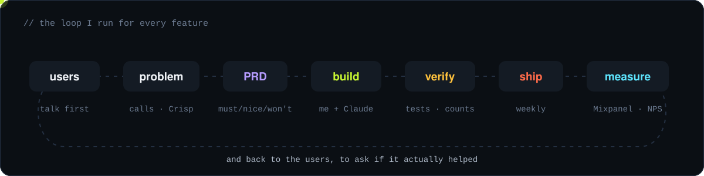
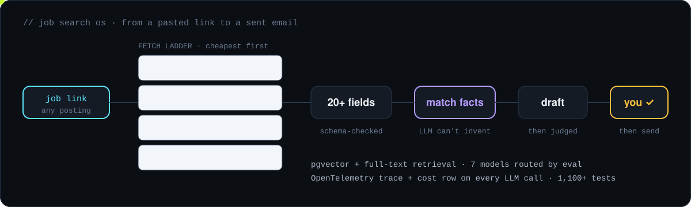
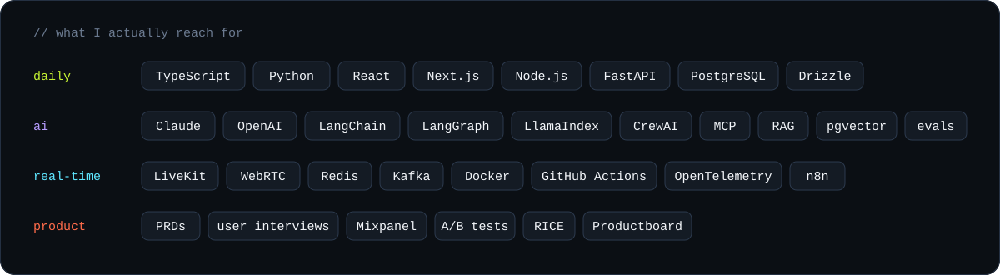

  

  
  
  
  

### Hey, I'm Saif 👋

I am a product engineer from India, working remotely for a UK startup. Most of my day goes between two things: talking to users, and writing the code that fixes what they told me.

Right now I am **Product Owner (Full Stack) at Louper**, a live video collaboration platform used by production companies and video houses. I build AI agents and internal workflows for our team, real-time features on LiveKit, and the data pipelines that tell us how people actually use the product. I like startups because nobody tells you "that's not your job".

These days Claude Code writes a lot of my code. I do the architecture, the specs, and the checking. The checking part I learned the hard way (see below).

 

## 🔁 How I work

Before I build anything I write a short PRD: the user problem, what must ship and what won't, edge cases, test cases, and what I expect it to change. Sometimes nobody reads it. I still write it, because it saves me from building the same prototype three times.

 

## 🛠️ What I've been building

<table>
<tr>
<td width="50%" valign="top">

#### [Job Search OS](https://github.com/SaifuddinSaifee/jobsearchos)
My own job search, turned into a product. Paste a job link and it pulls the posting from wherever it lives, matches it against facts from my real resumes, drafts the resume, cover letter and cold email, and waits for me to approve before anything is sent. The model is only allowed to pick from facts I have, not write new ones.

`Next.js` `TypeScript` `Postgres + pgvector` `LlamaIndex` `MCP` `OpenTelemetry`

</td>
<td width="50%" valign="top">

#### [Gather.io](https://github.com/SaifuddinSaifee/gatherio)
A SaaS that chases people for documents until every item is in, reviewed and accepted. No account needed for the person uploading, one-click reminders that list only what is still missing, and every submission versioned.

`Next.js` `TypeScript` `Postgres` `Drizzle` `pg-boss`

</td>
</tr>
<tr>
<td width="50%" valign="top">

#### At Louper
- AI agents and LLM workflows that took repetitive work off sales, CS, marketing and ops
- Desktop streaming into rooms and real-time captioning with meeting summaries, on WebRTC + LiveKit
- A session analytics pipeline built from LiveKit data, because Mixpanel was missing users behind ad blockers and company firewalls
- Release notes in one click: GitHub Actions + OpenAI, approved from a Slack modal

</td>
<td width="50%" valign="top">

#### Earlier
- **Psylief**: moved a Flask monolith to FastAPI services with Kafka and Redis at a four-person startup, without breaking the mobile app
- **SigLens**: an LLM feature for an open source observability tool that turns plain-English questions into log queries
- **GenSQL**: plain English to SQL, with an ETL step that turns CSV and Excel files into Postgres tables

</td>
</tr>
</table>

 

## 🧰 Stack

 

## 📜 So far

<b>🐛 Bugs that changed how I work</b>

 

**Only page 1 of 4.** I built an ETL at Louper that pulls room session data from LiveKit. I wrote the schema and test specs, Claude Code wrote the APIs and the cron job, and it went to production looking fine. A few days later a client told us they couldn't get into a room, and when we searched for that session it wasn't there. The API was paginated and we were only storing the first page. Now I count what should come in before ingestion, check what actually landed, retry the gap, and post every run to Slack. Later I rebuilt it so a real-time path and a cron job back each other up.

**Green tests, wrong code.** In Gather.io an agent-written draft save passed every unit test but read the status without a lock, so saving a draft could overwrite a reviewer's approval. I caught it in review and fixed it with row locks, forward-only status changes and version checks. Since then I read agent code the way I would read a junior's PR.

<b>🏆 Hackathons and community</b>

 

- Smart India Hackathon 2022, winner
- MumbaiHacks 2023, GenAI track winner
- GitHub Campus Expert
- Microsoft Learn Student Ambassador
- AWS Certified AI Practitioner
- B.Tech in Computer Engineering, SVKM's Institute of Technology (2024)

<b>☕ Random</b>

 

- I have worked with client IT teams across the US, UK, Germany, France, Singapore and South Africa, mostly on their time zones. Night shifts don't scare me.
- I like talking to users more than most engineers I know. Happy to jump on a call.
- On the side I am building a personal search tool for my own screen history.

 

## 📈 GitHub

  Open to product engineer and AI engineer roles. If you are building something early and messy, I would like to hear about it.

